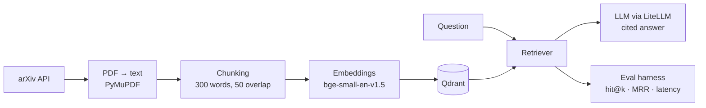

# arxiv-rag

**Ask questions about AI research papers and get cited answers, with every retrieval change measured.**

[](https://github.com/Sagar00789/arxiv-rag/actions/workflows/ci.yml)
[](https://colab.research.google.com/github/Sagar00789/arxiv-rag/blob/main/notebooks/colab_quickstart.ipynb)

A retrieval-augmented generation (RAG) system over arXiv papers on RAG and LLM agents.
The focus is less on "it works" and more on **how well it works and why**: each improvement
(chunking, hybrid search, reranking) is scored on a fixed test set, and the results are
logged in [`eval/RESULTS.md`](eval/RESULTS.md).

## Architecture



## Results

| Experiment | chunk hit@5 | chunk MRR | paper hit@5 | p50 latency |
|---|---|---|---|---|
| Baseline: dense retrieval | _running_ | | | |
| + Hybrid search (BM25 + dense, RRF) | _planned_ | | | |
| + Cross-encoder reranker | _planned_ | | | |
| + Section-aware chunking | _planned_ | | | |

Full log: [`eval/RESULTS.md`](eval/RESULTS.md). Test set: LLM-generated questions, one per
sampled chunk, reviewed by hand. The source chunk is the gold label.

## Quickstart

**Fastest:** click *Open in Colab* above and run all cells on a free T4 GPU.

**Locally:**
```bash
pip install -e ".[all,dev]"
cp .env.example .env              # add a free Gemini or Groq key
arxiv-rag ingest --max-results 50 # download and chunk papers
arxiv-rag index                   # embed into Qdrant
arxiv-rag ask "How does Self-RAG decide when to retrieve?"
arxiv-rag make-testset --n 50     # then review eval/testset.jsonl
arxiv-rag eval --name baseline-dense
uvicorn arxiv_rag.api:app --reload  # POST /ask at http://localhost:8000/docs
```

## Design decisions

- **LiteLLM for generation:** swap Gemini, Groq, Claude or GPT with one env var and compare them.
- **Embedded Qdrant:** a real vector DB with no server to run; the same code works against Qdrant Cloud.
- **Retrieval is evaluated separately from generation:** if the right chunk isn't retrieved,
  no prompt can fix the answer, so retrieval is measured first.
- **Offline tests:** a hashing embedder and in-memory Qdrant let CI run in seconds with no keys.

## Project layout

```
src/arxiv_rag/
  ingest.py      arXiv search, PDF download, text extraction
  chunking.py    cleaning (drops reference lists) and overlapping windows
  embed.py       embedding interface + sentence-transformers
  store.py       Qdrant wrapper
  retrieve.py    retrievers + indexing
  generate.py    cited-answer prompt, LLM call
  evaluation.py  test-set generation, hit@k / MRR, results log
  pipeline.py    retrieval + generation
  api.py         FastAPI service
  cli.py         `arxiv-rag` command
tests/           offline unit tests
notebooks/       Colab GPU quickstart
```

## Roadmap

- [x] Baseline pipeline, CLI, API, eval harness, CI
- [ ] Baseline numbers on a reviewed 50-question test set
- [ ] Hybrid retrieval (BM25 + dense with reciprocal rank fusion)
- [ ] Cross-encoder reranking
- [ ] Answer quality evals (faithfulness and citation accuracy, LLM-as-judge)
- [ ] Tracing and cost tracking (Langfuse)
- [ ] Web UI + live deployment
