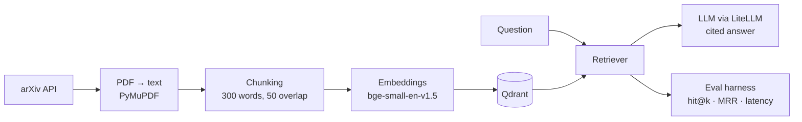

# arxiv-rag

**Ask questions about AI research papers and get cited answers, with every retrieval change measured.**

[](https://github.com/Sagar00789/arxiv-rag/actions/workflows/ci.yml)
[](https://colab.research.google.com/github/Sagar00789/arxiv-rag/blob/main/notebooks/colab_quickstart.ipynb)

A retrieval-augmented generation (RAG) system over arXiv papers on RAG and LLM agents.
The focus is less on "it works" and more on **how well it works and why**: each improvement
(chunking, hybrid search, reranking) is scored on a fixed test set, and the results are
logged in [`eval/RESULTS.md`](eval/RESULTS.md).

## Architecture



## Results

| Retriever | chunk hit@5 | chunk MRR | paper hit@5 | p50 latency |
|---|---|---|---|---|
| Dense (bge-small embeddings) | 0.60 | 0.42 | 0.94 | 17 ms |
| **BM25 (keywords)** | **0.88** | 0.72 | **0.98** | **5 ms** |
| Hybrid: dense + BM25, RRF | 0.72 | 0.59 | 0.96 | 27 ms |
| Hybrid + cross-encoder rerank | 0.84 | **0.73** | **0.98** | 878 ms |

Full log: [`eval/RESULTS.md`](eval/RESULTS.md). Test set: 50 LLM-generated questions
(gemini-3.5-flash-lite) across 32 papers, one per sampled chunk, reviewed by hand; the source
chunk is the gold label. Corpus: 49 arXiv papers on RAG and LLM agents → 1,681 chunks.

### What the numbers say

1. **BM25 wins, at a third of dense's latency.** Research papers are full of exact, rare terms
   (method names like "MAIN-RAG", dataset names, numbers) that keyword matching nails and a
   small embedding model blurs together. Dense retrieval finds the right *paper* (0.94) but
   often not the right *passage* (0.60).
2. **Hybrid made things worse than BM25 alone (0.72 vs 0.88).** Equal-weight fusion lets the
   weaker dense ranking push BM25's correct hits out of the top 5. Fusion pays off when the two
   retrievers are similarly strong and make *different* mistakes, which isn't the case here.
3. **The reranker recovers most of that loss and ranks best (MRR 0.73)**: when it finds the
   passage, it puts it nearer the top. But it is ~30× slower than hybrid (878 vs 27 ms on a T4), which
   matters for an interactive app.
4. **Caveat: this test set favours keyword search.** The questions were written by an LLM
   *looking at the passage*, so they reuse its exact wording. Real users paraphrase. The next
   experiment re-runs everything on paraphrased questions to see whether dense and hybrid
   close the gap when the wording doesn't match.

## Quickstart

**Fastest:** click *Open in Colab* above and run all cells on a free T4 GPU.

**Locally:**
```bash
pip install -e ".[all,dev]"
cp .env.example .env              # add a free Gemini or Groq key
arxiv-rag ingest --max-results 50 # download and chunk papers
arxiv-rag index                   # embed into Qdrant
arxiv-rag ask "How does Self-RAG decide when to retrieve?"
arxiv-rag make-testset --n 50     # then review eval/testset.jsonl
arxiv-rag eval -r dense -r bm25 -r hybrid -r hybrid-rerank
uvicorn arxiv_rag.api:app --reload  # POST /ask at http://localhost:8000/docs
```

## Design decisions

- **LiteLLM for generation:** swap Gemini, Groq, Claude or GPT with one env var and compare them.
- **Embedded Qdrant:** a real vector DB with no server to run; the same code works against Qdrant Cloud.
- **Retrieval is evaluated separately from generation:** if the right chunk isn't retrieved,
  no prompt can fix the answer, so retrieval is measured first.
- **Reciprocal rank fusion for hybrid search:** it merges rankings by position, not score, so
  BM25 and cosine scores (on totally different scales) never need tuning against each other.
- **Rerank only a shortlist:** the cross-encoder is far more accurate but about 100× slower per
  passage than an embedding lookup, so it re-scores just the top 30 hybrid candidates.
- **Offline tests:** a hashing embedder and in-memory Qdrant let CI run in seconds with no keys.

## Project layout

```
src/arxiv_rag/
  ingest.py      arXiv search, PDF download, text extraction
  chunking.py    cleaning (drops reference lists) and overlapping windows
  embed.py       embedding interface + sentence-transformers
  store.py       Qdrant wrapper
  retrieve.py    dense, BM25, hybrid (RRF) and reranking retrievers
  generate.py    cited-answer prompt, LLM call
  evaluation.py  test-set generation, hit@k / MRR, results log
  pipeline.py    retrieval + generation
  api.py         FastAPI service
  cli.py         `arxiv-rag` command
tests/           offline unit tests
notebooks/       Colab GPU quickstart
```

## Roadmap

- [x] Baseline pipeline, CLI, API, eval harness, CI
- [x] Baseline numbers on a reviewed 50-question test set (49 papers, 1,681 chunks)
- [x] Hybrid retrieval (BM25 + dense with reciprocal rank fusion)
- [x] Cross-encoder reranking
- [x] Measure all retrievers on the test set (BM25 wins; see analysis above)
- [ ] Paraphrased test set to check the keyword-overlap bias
- [ ] Weighted fusion and BM25 + rerank
- [ ] Answer quality evals (faithfulness and citation accuracy, LLM-as-judge)
- [ ] Tracing and cost tracking (Langfuse)
- [ ] Web UI + live deployment
