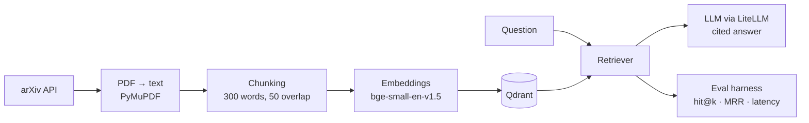

# arxiv-rag

**Ask questions about AI research papers and get cited answers, with every retrieval change measured.**

[](https://github.com/Sagar00789/arxiv-rag/actions/workflows/ci.yml)
[](https://colab.research.google.com/github/Sagar00789/arxiv-rag/blob/main/notebooks/colab_quickstart.ipynb)

**Live demo:** _deploying to Hugging Face Spaces (link coming)_

A retrieval-augmented generation (RAG) system over arXiv papers on RAG and LLM agents.
The focus is less on "it works" and more on **how well it works and why**: each improvement
(chunking, hybrid search, reranking) is scored on a fixed test set, and the results are
logged in [`eval/RESULTS.md`](eval/RESULTS.md).

## Architecture



## Results

Two test sets with the **same 50 gold passages**, asked two ways:
- **Original:** LLM-written while looking at the passage, so the questions reuse its words
  (keyword-friendly, the "easy" end).
- **Paraphrased:** rewritten as someone who hasn't read the paper would ask: synonyms, and
  methods described instead of named. Only 11% of its words appear in the original questions
  (the "hard" end); on average 30% of a paraphrased question's words appear in its gold
  passage. Real users sit somewhere in between.

**Chunk hit@5:** is the exact gold passage in the top 5?

| Retriever | Original | Paraphrased | Average | p50 latency (T4) |
|---|---|---|---|---|
| Dense (bge-small embeddings) | 0.60 | 0.22 | 0.41 | 17 ms |
| BM25 (keywords) | **0.88** | 0.26 | 0.57 | **5 ms** |
| Hybrid, equal weights (RRF) | 0.72 | **0.50** | 0.61 | 27 ms |
| **Hybrid, 80% BM25** (`hybrid@0.8`) | 0.82 | 0.46 | **0.64** | 28 ms |
| BM25 → cross-encoder rerank | **0.88** | 0.44 | **0.66** | 818 ms |
| Hybrid equal → rerank | 0.84 | 0.42 | 0.63 | 878 ms |

Full metrics (MRR, paper-level hit@5) in [`eval/RESULTS.md`](eval/RESULTS.md). Corpus: 49 arXiv
papers on RAG and LLM agents → 1,681 chunks. With n = 50, the standard error of each hit rate is
about ±0.07, so gaps under ~0.1 aren't meaningful; gaps like 0.26 → 0.50 are.

### What the numbers say

1. **The "best" retriever depends on how people ask.** BM25 wins when the question shares the
   passage's words (0.88) and collapses when it doesn't (0.26). Dense retrieval is weak on both
   with this small embedding model.
2. **Hybrid search pays off exactly when its parts make different mistakes.** On original
   questions BM25 is right almost everywhere dense is, so equal fusion only adds dense's noise
   (0.72 < 0.88). On paraphrased questions they fail on *different* questions, and fusion nearly
   doubles either one alone (0.50 vs 0.26 / 0.22).
3. **`hybrid@0.8` is the best fast all-rounder:** close to BM25 on easy questions, close to
   equal hybrid on hard ones, with a 28 ms median latency. The weight was fixed *before* seeing
   these results, not tuned on them. **It's now the default retriever.**
4. **The reranker helps on easy questions and doesn't help on hard ones.** It lifts hybrid from
   0.72 to 0.84 on original questions, and rescues BM25 on paraphrased ones (0.26 → 0.44). But on
   paraphrased questions it *lowers* equal hybrid from 0.50 to 0.42. I expected the opposite.
   My reading: `bge-reranker-base` also leans on shared wording, and with method names stripped
   out it promotes plausible-sounding passages from *other* papers (paper-level hit@5 drops
   from 0.80 to 0.76). The gap is within noise, but there's clearly no gain to pay 30× latency
   for. Reranking isn't a free upgrade: it has to be measured on the questions you actually expect.
5. **A subtle one: `hybrid@0.8-rerank` scored exactly the same as `bm25-rerank`.** At 80/20,
   a passage found only by dense scores at most 0.2/61 ≈ 0.0033, while BM25's 30th result
   scores 0.8/90 ≈ 0.0089. So the reranker's 30 candidates are always exactly BM25's: the
   weighting silently removed dense from the candidate pool.

### Answer quality

Retrieval metrics only say whether the right passage was *found*. `arxiv-rag eval-answers`
also grades the final answers with an LLM judge (a different model from the one answering):

- **Faithfulness:** share of the answer's claims supported by the passages it was given
- **Citation accuracy:** share of `[n]` citations pointing at a passage that supports the sentence
- **Correctness:** agreement with the reference answer (yes / partial / no)
- **Correct when gold retrieved:** separates retrieval failures from generation failures

_Results: running (see [`eval/ANSWERS.md`](eval/ANSWERS.md))._

### Next experiments
- **Bigger embedding models** (bge-base / bge-large, now supported with `-e`): dense is the weak
  link on both sets, and the only component that could close the gap on paraphrased questions.
- **A stronger reranker** (e.g. bge-reranker-v2-m3) to test whether the reranker result is about
  this model or about reranking in general.

## Quickstart

**Fastest:** click *Open in Colab* above and run all cells on a free T4 GPU.

**Locally:**
```bash
pip install -e ".[all,dev]"
cp .env.example .env              # add a free Gemini or Groq key
arxiv-rag ingest --ids-file eval/paper_ids.txt  # the exact 49 papers behind the results
arxiv-rag index                   # embed into Qdrant
arxiv-rag ask "How does Self-RAG decide when to retrieve?"
arxiv-rag make-testset --n 50     # then review eval/testset.jsonl
arxiv-rag eval -r dense -r bm25 -r hybrid -r hybrid-rerank
arxiv-rag paraphrase-testset      # questions reworded away from the passage's wording
arxiv-rag eval -r bm25 -r hybrid@0.8 -r bm25-rerank --testset eval/testset_paraphrased.jsonl
arxiv-rag index -e BAAI/bge-base-en-v1.5    # another embedding model, its own collection
arxiv-rag eval -r dense -e BAAI/bge-small-en-v1.5 -e BAAI/bge-base-en-v1.5
arxiv-rag eval-answers -r hybrid@0.8 --n 25 --judge-model gemini/gemini-3.8-flash
arxiv-rag ui                      # web demo at http://localhost:7860 (pip install -e ".[ui]")
uvicorn arxiv_rag.api:app --reload  # POST /ask at http://localhost:8000/docs
```

## Design decisions

- **LiteLLM for generation:** swap Gemini, Groq, Claude or GPT with one env var and compare them.
- **Embedded Qdrant:** a real vector DB with no server to run; the same code works against Qdrant Cloud.
- **Retrieval is evaluated separately from generation:** if the right chunk isn't retrieved,
  no prompt can fix the answer, so retrieval is measured first.
- **Reciprocal rank fusion for hybrid search:** it merges rankings by position, not score, so
  BM25 and cosine scores (on totally different scales) never need tuning against each other.
- **Rerank only a shortlist:** the cross-encoder is far more accurate but about 100× slower per
  passage than an embedding lookup, so it re-scores just the top 30 hybrid candidates.
- **Offline tests:** a hashing embedder and in-memory Qdrant let CI run in seconds with no keys.

## Project layout

```
src/arxiv_rag/
  ingest.py      arXiv search, PDF download, text extraction
  chunking.py    cleaning (drops reference lists) and overlapping windows
  embed.py       embedding interface + sentence-transformers
  store.py       Qdrant wrapper
  retrieve.py    dense, BM25, hybrid (RRF) and reranking retrievers
  generate.py    cited-answer prompt, LLM call
  evaluation.py  test sets (generate, paraphrase), hit@k / MRR, word overlap, results log
  answer_eval.py LLM-judge grading: faithfulness, citation accuracy, correctness
  pipeline.py    retrieval + generation
  api.py         FastAPI service
  cli.py         `arxiv-rag` command
  ui.py          Gradio web demo
tests/           offline unit tests
notebooks/       Colab GPU quickstart
space/           Hugging Face Spaces image; .github/workflows/deploy-space.yml deploys it
eval/            test sets, results logs, and the arXiv IDs of the corpus
```

## Roadmap

- [x] Baseline pipeline, CLI, API, eval harness, CI
- [x] Baseline numbers on a reviewed 50-question test set (49 papers, 1,681 chunks)
- [x] Hybrid retrieval (BM25 + dense with reciprocal rank fusion)
- [x] Cross-encoder reranking
- [x] Measure all retrievers on the test set (BM25 wins; see analysis above)
- [x] Paraphrased test set + word-overlap measurement (`paraphrase-testset`)
- [x] Weighted fusion (`hybrid@0.8`) and BM25 + rerank (`bm25-rerank`)
- [x] Results on both test sets → `hybrid@0.8` is the default retriever
- [x] Answer-quality evals (faithfulness, citation accuracy, correctness; LLM-as-judge)
- [x] Multiple embedding models side by side
- [ ] Results for both of the above
- [ ] Tracing and cost tracking (Langfuse)
- [x] Web UI (Gradio) + auto-deploy to Hugging Face Spaces
- [ ] Live demo link
